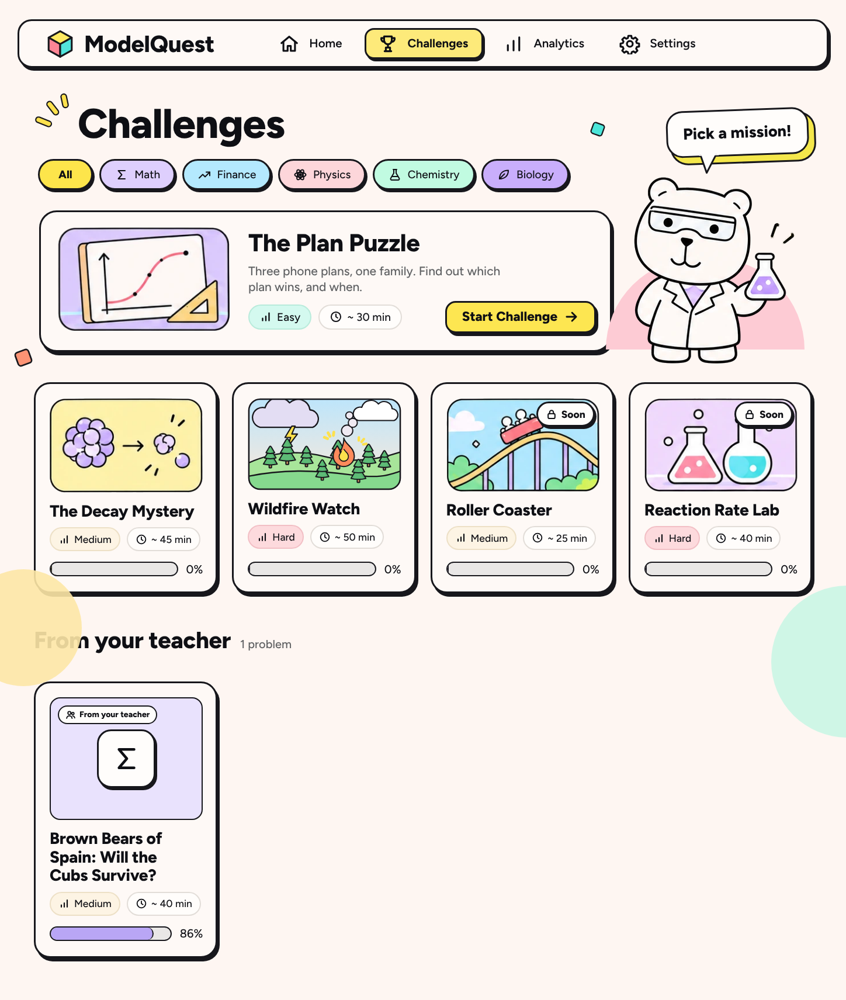
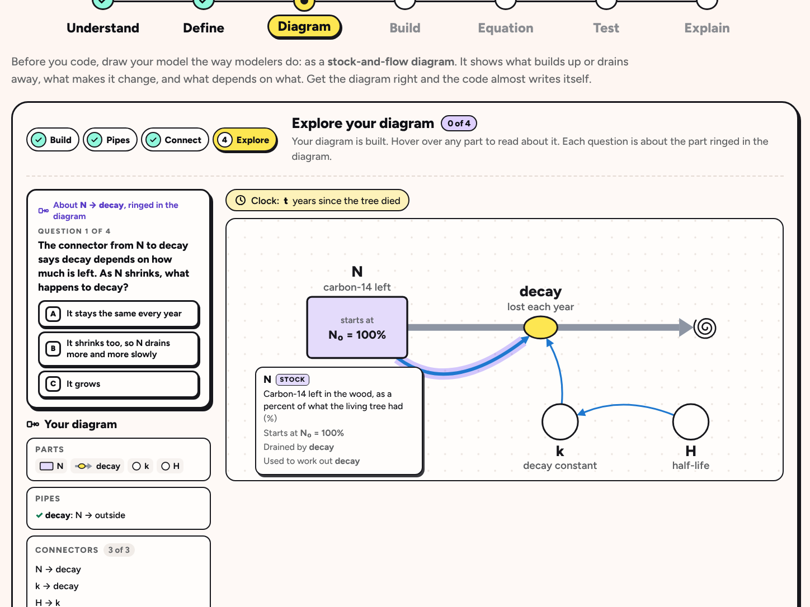
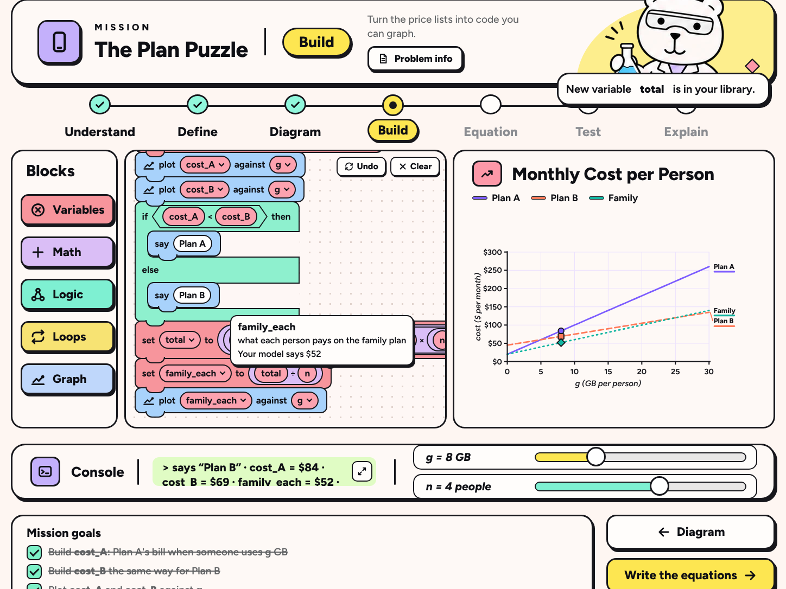
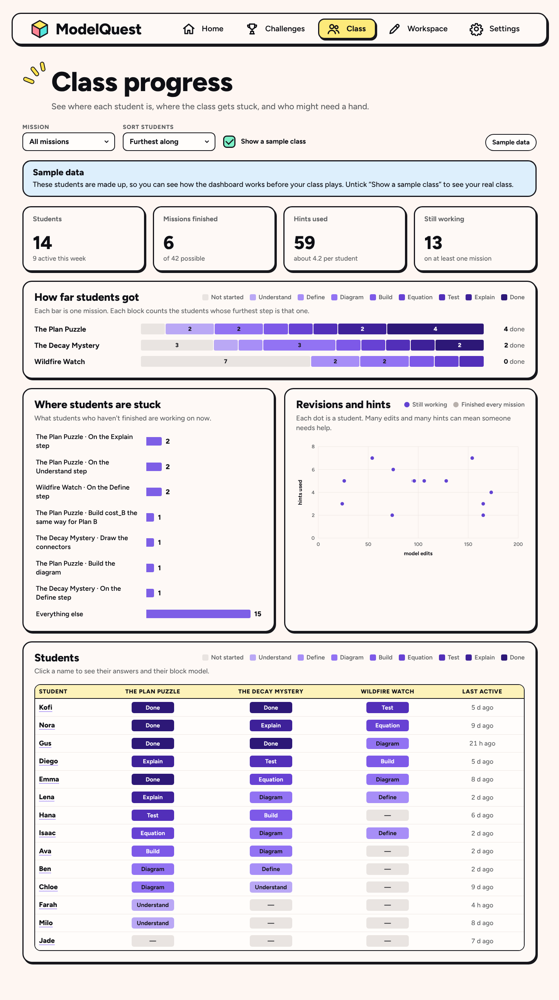

# ModelQuest

**Model. Code. Explore. Solve.** ModelQuest is a game for learning mathematical modeling and computational thinking. Students take a real situation, define its quantities, draw it as a stock-and-flow diagram, build it in Scratch-style blocks, write it as equations, test it, and use it to answer a real question.



## Try it

Download or clone this repository and open `index.html` in a modern browser (Chrome, Edge, Firefox or Safari). Nothing needs to be installed. An internet connection is only needed for the web fonts and for reading uploaded worksheets.

Opened this way, the app runs in **local mode**: every mission works and progress is saved in your browser. Class features (the live teacher dashboard, sharing teacher-made problems, AI drafting) need a backend; see [Running with a backend](#running-with-a-backend).

## What's inside

**Three missions**

| Mission | Math | The question |
|---|---|---|
| The Plan Puzzle | Linear functions | Which phone plan is cheaper for 8 GB a month, and for a family of four? |
| The Decay Mystery | Exponential decay, logarithms | How old is a wooden bowl, judging by the carbon-14 left in it? |
| Wildfire Watch | Probability, simulation | How much should a fire district thin a forest? |

**Seven steps in every mission:** Understand → Define → Diagram → Build → Equation → Test → Explain.

| Diagram step | Build step |
|---|---|
|  |  |

**Teacher tools:** a live class dashboard, a problem editor, and AI help to draft new problems from a topic or an uploaded worksheet. Teacher-made problems run through the same seven steps, generated from the teacher's formulas.



## Project structure

```
index.html        the built app (open this)
assets/           mascot and scene artwork
src/              source files that build.py joins into index.html
build.py          the build script
tests/            automated browser tests (Playwright)
docs/             design notes for the Diagram and Equation steps, screenshots
shots/            where tests save screenshots (not committed)
```

| Source file | What it holds |
|---|---|
| `src/p1_head.html` | All the CSS (design tokens are in `:root` at the top) |
| `src/p2_shell.html` | The page skeleton: nav bar and the `#view` container |
| `src/j1_core.js` | Shared helpers, icons, image paths |
| `src/j2_app.js` | Saved state, router, mission registry, shared step screens |
| `src/j6_blocks.js` | The block editor and block compiler |
| `src/j3_plans.js`, `src/j4_decay.js`, `src/j5_fire.js` | The three missions |
| `src/j7_cloud.js` | Database and sign-in layer, formula parser, AI calls |
| `src/j7b_custom.js` | Turns teacher problems into missions |
| `src/j7d_equation.js`, `src/j7e_diagram.js` | The Equation and Diagram steps |
| `src/j7c_teacher.js` | Teacher dashboard, workspace and editor |
| `src/j8_motion.js` | Animations (all skipped under reduced motion) |
| `src/j9_boot.js` | Starts the app |

## Build

Edit files in `src/`, then rebuild:

```
python3 build.py
```

There is no framework and no bundler. The files share one global scope, so the order in `build.py` matters.

## Run the tests

```
npm install
npx playwright install chromium
npm test                                  # main suite
node tests/bt.js tests/e2e_decay.js       # one test
```

Tests open `index.html` in a headless browser, play through the missions, and save screenshots to `shots/`. Use `W=390 HH=844 TOUCH=1 node tests/bt.js tests/dg2_phone.js` to test at phone size.

## How it works

- **Missions engine.** Each mission is an object in `MISSIONS` with an array of seven step functions. The app renders whichever step the student is on and unlocks Next when that step's checks pass. Teachers can jump to any step.
- **Block compiler.** Blocks are saved as a JSON tree. `compileProgram()` turns the tree into plain JavaScript functions (no `eval`). Each block reports its own errors.
- **Running the model.** `modelRunner(V, prog).at(inputs)` runs the compiled model with given inputs. The graph, the goal checks, the Test step and the Wildfire simulation all call it. Answers are checked by comparing outputs at several inputs, so any equivalent form is accepted. Chance uses a seeded random generator, so runs can be repeated.
- **Data.** Progress is saved in the browser. In the original version the app was published as a Claude artifact on claude.ai, which provided a shared database (students' progress, teacher problems, teacher-only answer keys, class settings), sign-in, file storage and AI. Without that, `cloudInit()` in `j7_cloud.js` falls back to a local database in `localStorage`.

## Running with a backend

To run class features on your own hosting, replace the platform calls in `src/j7_cloud.js`:

- **Database and sign-in:** for example Firebase or Supabase. The app's data code already uses Firestore-style calls (`collection`, `doc`, `get`, `set`, `onSnapshot`), so the local fallback `localDB()` shows the interface to implement. Recreate the access rules: students read and write only their own `progress/<id>`; teachers read all progress; `problems` readable by students, writable by teachers; `keys` (answer keys) teachers only.
- **AI:** a small server function that calls the Anthropic API. Keep the API key on the server, never in the page.
- **Students under 18:** if students sign in, use an approved school sign-in and follow student-privacy rules (such as FERPA and COPPA).

## Change or extend it

- **Look and feel:** colours, fonts and sizes are CSS variables in `:root` at the top of `src/p1_head.html`.
- **A new mission:** copy one of `j3_plans.js`, `j4_decay.js` or `j5_fire.js`, give it a new key in `MISSIONS`, add it to `order` in `j2_app.js`, add its artwork to `ARTS` in `j1_core.js`, and add the file to `build.py`.
- **A new problem without code:** in the app, use teacher mode and the Workspace editor.

## Docs

- [Diagram step](images/diagram-step.md)
- [Equation step](images/equation-step.md)

## Acknowledgements

Built with help from Claude (Anthropic). Stock-and-flow notation follows Shiflet & Shiflet, *Introduction to Computational Science*.

## License

[MIT](LICENSE). You are free to use, copy and modify this project.
